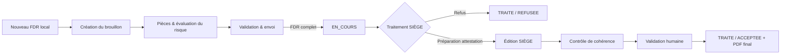

# Attestation de chantier — FDR

Application web de démonstration pour la gestion d'une demande d'attestation de chantier à partir d'un **formulaire de déclaration du risque (FDR)**.

Le parcours couvre la saisie côté distributeur, la détection automatique des justificatifs requis, l'envoi au SIÈGE, le traitement de la demande, la génération documentaire et un contrôle de cohérence assisté par IA.

## Fonctionnalités principales

- authentification JWT avec rôles `DISTRIBUTEUR` et `SIEGE` ;
- création et reprise d'un FDR en brouillon ;
- validation métier du formulaire et détection automatique des pièces requises ;
- upload de justificatifs PDF/JPG/PNG ;
- évaluation automatique **fictive et déterministe** du risque ;
- envoi au SIÈGE avec génération d'un PDF FDR figé ;
- consultation, refus ou demande de compléments côté SIÈGE ;
- génération et édition WYSIWYG d'un projet d'attestation côté distributeur ;
- préparation, prévisualisation et validation d'une attestation définitive côté SIÈGE ;
- contrôle de cohérence entre FDR et attestation via Mistral ou un backend de simulation ;
- notifications applicatives, relance email avec délai de 24 h et reporting synthétique.

## Parcours métier



Le **PDF FDR**, le **projet d'attestation du distributeur** et l'**attestation définitive SIÈGE** sont trois artefacts distincts. Leur cycle est détaillé dans [`docs/diagrams/cycle-documents.md`](docs/diagrams/cycle-documents.md).

## Architecture

| Zone | Technologies / rôle |
| --- | --- |
| Frontend | React 18, TypeScript 6, Vite 8, React Router, TanStack Query, React Hook Form + Zod, Canopée 1.8.0, Quill |
| Backend | Django 6.1, Django REST Framework, SimpleJWT, Pydantic, Bleach |
| Données | PostgreSQL |
| Documents | ReportLab pour le FDR ; xhtml2pdf pour les attestations |
| Fichiers | filesystem local en développement ; Azure Blob Storage privé si configuré |
| IA | Mistral avec sortie structurée Pydantic ; simulation déterministe disponible |
| Déploiement | frontend Azure Static Web Apps ; backend conteneurisé avec Gunicorn, compatible Azure Container Apps |

Le frontend sépare l'état local du formulaire, l'état serveur et la navigation :

- **React Hook Form + Zod** pour la saisie locale du FDR ;
- **TanStack Query** pour les données serveur et les mutations ;
- **React Router** pour l'étape courante du parcours ;
- pas de store global métier supplémentaire.

Le backend centralise les règles documentaires dans des fonctions pures et applique les permissions et transitions d'état au niveau API.

Voir [`docs/02-architecture.md`](docs/02-architecture.md) et [`docs/diagrams/architecture.md`](docs/diagrams/architecture.md).

## Démarrage local

### Prérequis

- Python 3.12 ;
- Node.js `^22.12.0` ou `>=24` ;
- Docker, pour lancer PostgreSQL facilement.

### Base de données

```bash
docker compose up -d db
```

### Backend

```bash
cp backend/.env.example backend/.env
python -m venv .venv
source .venv/bin/activate        # Windows : .venv\Scripts\activate
pip install -r backend/requirements.txt
cd backend
python manage.py migrate
python manage.py runserver
```

Le fichier `backend/.env` doit rester local et ne doit jamais être versionné.

L'application suppose actuellement **exactement un compte `SIEGE`** pour les notifications d'envoi et les relances. Aucun jeu de données ou compte de démonstration n'est créé automatiquement par le dépôt.

### Frontend

Dans un autre terminal :

```bash
cp frontend/.env.example frontend/.env
cd frontend
npm ci
npm run dev
```

Par défaut, `VITE_API_BASE_URL` vaut `http://localhost:8000/api` dans l'exemple d'environnement.

## Tests et contrôles

Backend :

```bash
cd backend
python manage.py test
python manage.py check
python manage.py makemigrations --check
```

Frontend :

```bash
cd frontend
npm test
npm run lint
npm run build
```

Le dépôt contient 271 méthodes de test backend et 24 fichiers de tests frontend. Des contrôles `jest-axe` sont utilisés sur plusieurs écrans, sans constituer un audit ni une déclaration de conformité RGAA.

Voir [`docs/08-tests.md`](docs/08-tests.md).

## Documentation

- [01 — Fonctionnel](docs/01-fonctionnel.md)
- [02 — Architecture](docs/02-architecture.md)
- [03 — Modèle de données](docs/03-modele-donnees.md)
- [04 — API](docs/04-api.md)
- [05 — Choix techniques](docs/05-choix-techniques.md)
- [06 — IA et contrôle de cohérence](docs/06-ia-coherence.md)
- [07 — Sécurité](docs/07-securite.md)
- [08 — Tests](docs/08-tests.md)
- [09 — Installation et déploiement](docs/09-installation-deploiement.md)
- [10 — Limites et évolutions](docs/10-limites-evolutions.md)

Diagrammes :

- [Architecture](docs/diagrams/architecture.md)
- [Workflow d'une demande](docs/diagrams/workflow-demande.md)
- [Cycle des documents](docs/diagrams/cycle-documents.md)
- [Modèle de données](docs/diagrams/modele-donnees.md)
- [Validation de l'attestation](docs/diagrams/validation-attestation.md)

## Points de sécurité structurants

- autorisations backend par rôle et ownership ;
- aucun `MEDIA_URL` public pour les pièces métier ;
- stockage des fichiers sous des chemins opaques ;
- sanitization HTML serveur par liste blanche avant persistance ;
- validation des extensions et types MIME des justificatifs ;
- transactions et verrous sur les transitions critiques ;
- secrets attendus via variables d'environnement.

La version actuelle stocke toutefois les JWT dans `localStorage`. Cette décision simplifie la démonstration mais laisse un risque XSS plus important qu'une stratégie basée sur cookies `HttpOnly`. Les limites et pistes d'amélioration sont décrites dans [`docs/10-limites-evolutions.md`](docs/10-limites-evolutions.md).

## Déploiement

Le dépôt fournit :

- un `Dockerfile` backend exécutant Gunicorn sur le port `8000` ;
- un endpoint de santé `GET /healthz` ;
- un workflow GitHub Actions pour le build et le déploiement du frontend sur Azure Static Web Apps ;
- la configuration du stockage Azure Blob privé, de PostgreSQL, du SMTP et de Mistral par variables d'environnement.

Le provisioning de l'infrastructure Azure et le déploiement du backend ne sont pas décrits en Infrastructure as Code dans cette version. Voir [`docs/09-installation-deploiement.md`](docs/09-installation-deploiement.md).
