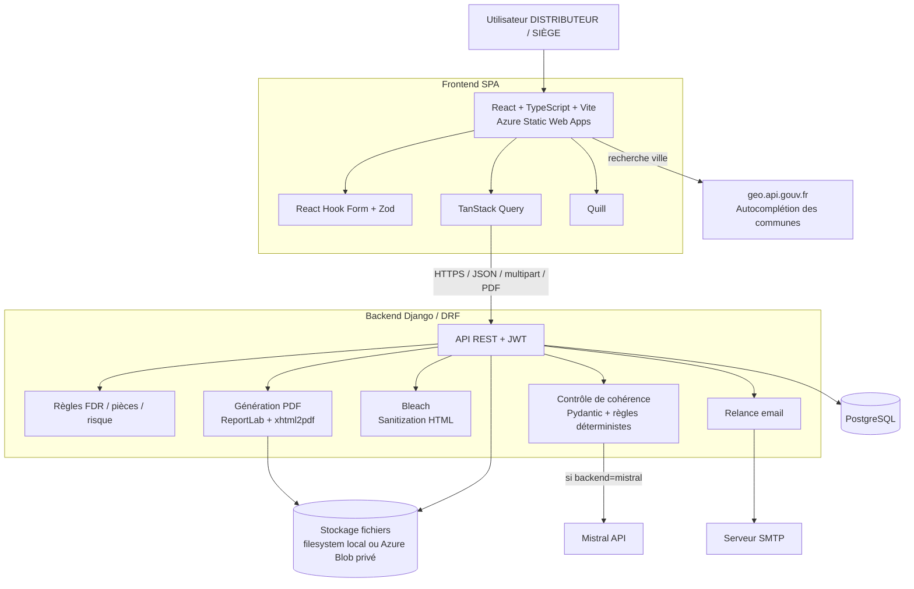

# Diagramme — Architecture

## Notes

- Le navigateur appelle directement `geo.api.gouv.fr` pour l'autocomplétion des communes.
- Les fichiers métier ne sont pas exposés par un `MEDIA_URL` public.
- Le backend conserve la source de vérité pour les permissions, les transitions, les règles de pièces et la validation finale.
