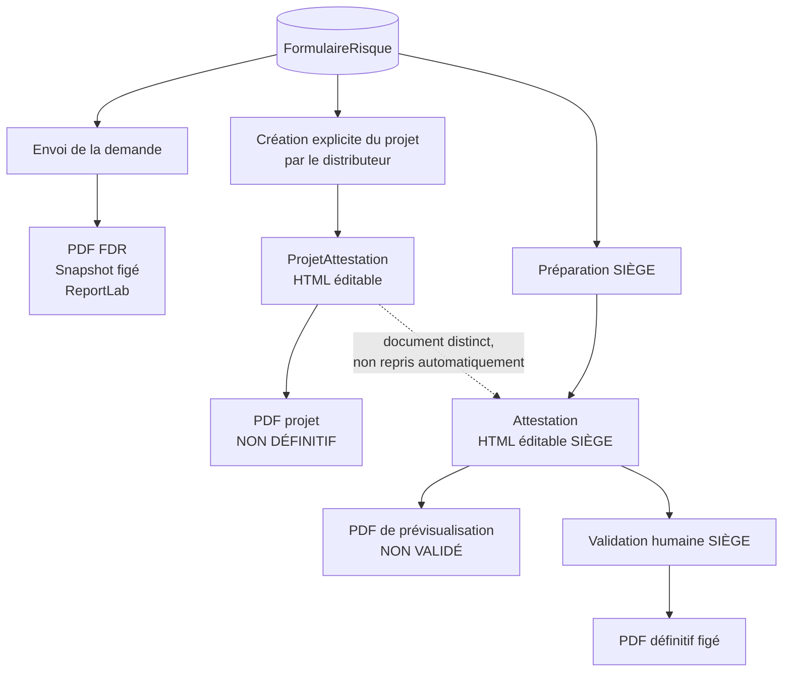

# Diagramme — Cycle des documents

## Propriété importante

`ProjetAttestation` et `Attestation` sont indépendants. La préparation SIÈGE appelle le générateur de contenu initial à partir du FDR ; elle ne copie pas automatiquement le HTML du projet distributeur.
