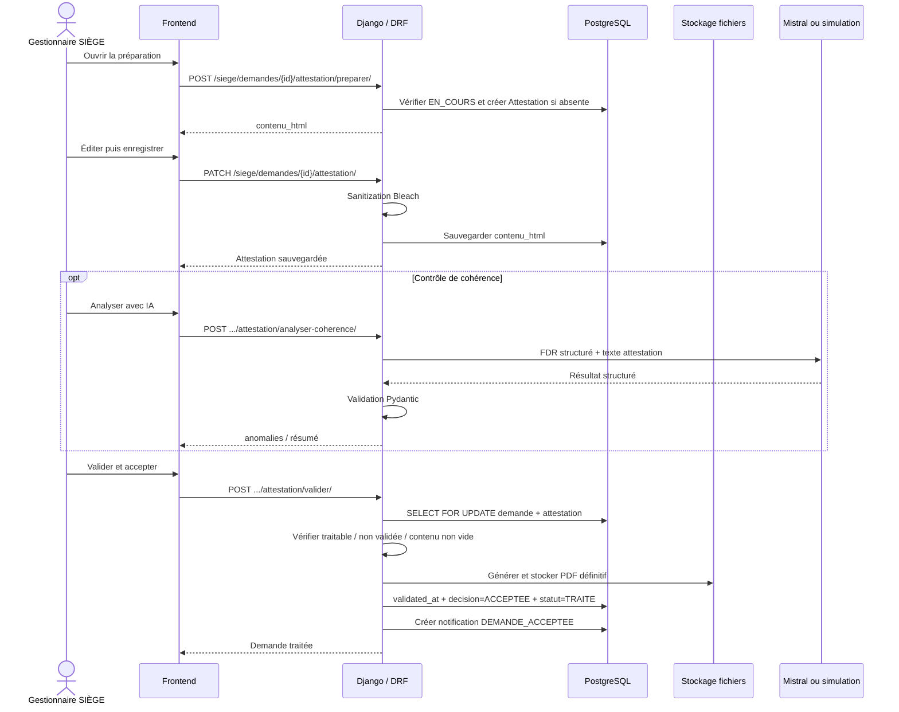

# Diagramme — Validation de l'attestation

## Principe

Le résultat du contrôle IA n'est pas une précondition technique de `valider`. Le SIÈGE peut prendre sa décision indépendamment de l'analyse automatique.
