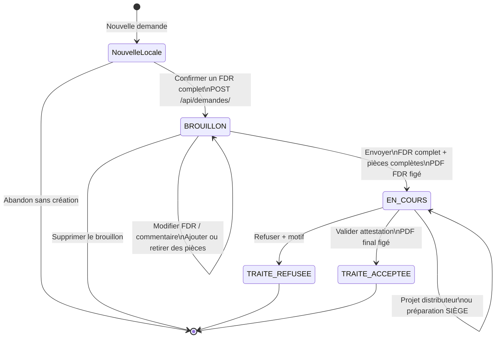

# Diagramme — Workflow d'une demande



## États persistés

La base ne stocke que :

- `BROUILLON`
- `EN_COURS`
- `TRAITE`

Les deux états finaux du diagramme correspondent à :

```text
TRAITE + decision=REFUSEE
TRAITE + decision=ACCEPTEE
```
